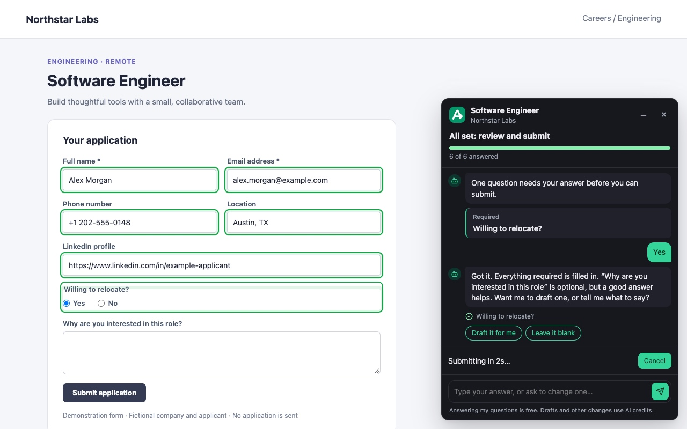

<div align="center">

# ApplyShortly

### 100% Free & Open-source Chrome extension for job application autofill, AI-assisted answers and application tracking.

Stop retyping the same details. Fill **job applications** from your saved profile and answers, review the form, then submit with confidence.

[](LICENSE)
[](#requirements)
[](https://chromewebstore.google.com/detail/apply-shortly-form-assist/pdeffhelbeobnpcbjdegddcfimglmedd)
[](#requirements)
[](#safety-and-privacy)

[Quick start](#quick-start) · [Features](#features) · [How it works](#how-it-works) · [FAQ](#faq) · [Contributing](#contributing)

[Install from the Chrome Web Store](https://chromewebstore.google.com/detail/apply-shortly-form-assist/pdeffhelbeobnpcbjdegddcfimglmedd) · [Open ApplyShortly Platform](https://applyshortly.com)

**Platform:** [https://applyshortly.com](https://applyshortly.com)

</div>



*Fill your application, answer screening questions in chat, then review and submit. Fictional demonstration; no application is sent.*

---

## What is ApplyShortly?

**Apply Shortly Form Agent** is an MIT-licensed **job application autofill Chrome extension**. It fills contact details, work experience, education, links and screening questions from your ApplyShortly profile and saved answer bank. Use it as a **job application form filler**, an **AI application assistant**, and a way to track supported applications in your account.

Profile and saved-answer fills are 100% free forever with no credit card required. Optional AI drafts use ApplyShortly credits, a connected assistant (ChatGPT, Claude or Gemini via MCP), or your own supported provider key. A compatible ApplyShortly server and an account are required; the backend and website are maintained separately.

> Today: **autofill, multi-step forms, on-page chat and application tracking**. Review answers and submit yourself, or explicitly choose Auto apply with a cancellable countdown. Form support varies by website.

## Features

- **Job application autofill:** reuse contact details, work history, education, links and saved screening answers.
- **Multi-step form agent:** step through application pages, pop-ups and embedded forms on pages you start it on.
- **Answer in chat:** respond to remaining questions or ask the assistant to change an answer in plain words.
- **Optional AI drafts:** draft open-ended answers from your profile and the job, then review and edit them.
- **Review progress:** see which fields are filled and which still need your input.
- **User-chosen Auto apply:** check detected required fields and browser validity, then submit after a three-second countdown with Cancel.
- **Application tracking:** keep attempts and confirmed submissions in your ApplyShortly account for supported applications.
- **Open source:** inspect the extension, build it yourself and connect it to a compatible server.

## Quick start

1. [Install Apply Shortly Form Agent](https://chromewebstore.google.com/detail/apply-shortly-form-assist/pdeffhelbeobnpcbjdegddcfimglmedd) from the Chrome Web Store.
2. Sign in to [ApplyShortly](https://applyshortly.com), save your profile, résumé and application answers, then check your connection in extension settings.
3. Open a job application and choose **Fill this form**, or press **Alt+Shift+F**.
4. Answer remaining questions, review the form and attachments, then submit yourself or choose **Submit for me (Auto apply)**.

Then: **save your profile → open an application → autofill → review → submit.**

The store version connects to `https://applyshortly.com` and updates automatically. For a custom server or local development, see [build from source](#build-from-source).

## How it works

1. **Connect your account:** the extension retrieves your saved ApplyShortly profile and answers.
2. **Fill the application:** it discovers the form fields and inserts matching details. The form agent helps with multi-step pages and embedded forms.
3. **Complete missing answers:** answer screening questions in the chat panel or request an optional AI draft.
4. **Review and submit:** check answers, attachments and consent. Submit on the employer's site, or explicitly choose Auto apply with its checks and cancellable countdown.
5. **Track the outcome:** an attempt needs verification until an employer receipt or your confirmation establishes that it was submitted.

For account setup, AI settings, screenshots and troubleshooting, see the [extension guide](extension/README.md).

## Requirements

- **Chrome 125 or later** and an ApplyShortly account with a saved profile for autofill.
- **A compatible ApplyShortly server.** The Chrome Web Store package uses the hosted service. Custom builds can connect to another compatible server.
- **No personal AI API key required.** Profile and saved-answer fills need no AI key; optional AI features can use ApplyShortly credits. Personal provider keys are optional, and provider charges may apply.
- **For source builds:** Node.js 22+ and Python 3.10+. End users installing from the store do not need these tools or Claude Code.

## Where data lives

Your profile, saved answers and tracked applications live in your connected ApplyShortly account. The extension keeps its connection credential, preferences and short-lived panel state in extension storage. Credentials and platform requests are handled by the background worker.

The current source build also supports answer drafts, assistant chat and AI-led form planning through a user-configured OpenAI-compatible endpoint, including a local server. The extension sends relevant profile, job, conversation and observed form details directly to that endpoint; the key stays in trusted extension storage on the device. Select the extension form filling method in extension settings; platform sessions use a separate setting on the website. AI-led is the default for both. Custom AI-led planning requires a compatible server and a model that returns the requested JSON; screenshots are not sent to the custom provider.

For the existing ApplyShortly-managed providers, AI requests pass through the server and personal keys are stored encrypted there. An ApplyShortly server and account remain required in both modes. The custom endpoint feature requires a build containing these changes; its availability in the Chrome Web Store depends on a future release.

## Build from source

Use Node.js 22+ and Python 3.10+.

```sh
npm ci
npm run check
npm run build -- --platform-url https://your-applyshortly-host.example
```

The build creates `dist/extension/` and a versioned ZIP. In `chrome://extensions`, enable Developer mode, choose **Load unpacked**, and select `dist/extension/`. Open the extension's settings and sign in. Rebuild and reload the extension after changing the server origin.

The platform URL is selected from `--platform-url`, `FRONTEND_URL` in the environment, `FRONTEND_URL` in a local `.env`, then `http://localhost:3000`. Only the public origin is packaged. Never add credentials to source files.

The familiar Make commands are also available from this repository root:

```sh
make install
make extension-build platform_url=https://applyshortly.com
make extension-test
make extension-source platform_url=https://applyshortly.com
```

Run `make help` for the command list. Without `platform_url`, builds use the same
environment, local `.env` and localhost defaults as the npm commands. In Chrome's
**Load unpacked** picker, select `dist/extension/` inside this repository.

For automatic browser sign-in, the server operator must register the installed extension ID in `EXTENSION_IDS`. Unregistered installations can use user-approved code pairing. See the [extension guide](extension/README.md) for setup, manual connection, AI settings, form behavior and limitations.

## Safety and privacy

Review filled answers, AI drafts and attachments before submission. The form agent never clicks final Submit itself. Auto apply requires your explicit choice, including clicking Apply for a job in ApplyShortly through a one-time link, and uses a cancellable countdown. Sign-in, CAPTCHAs, uploads, consent and unsupported controls may require your input.

Form questions and answers are processed for filling and assistant features. The current shared AI-led form agent sends structured visible page context to its AI provider, without screenshots. Earlier Platform AI versions could send transient screenshots; the server-browser agent still uses them. Filled information is visible to the employer website before submission; submitting sends the application and attachments to that employer or its application service.

Custom builds support compatible self-hosted servers. This public repository contains the extension and API bridge; the platform backend is maintained separately. See the [privacy disclosure](docs/security/extension-privacy-policy.md), [hosted privacy policy](https://applyshortly.com/privacy) and [Chrome permissions guide](extension/README.md#why-it-asks-for-these-permissions).

## FAQ

**Is ApplyShortly autofill free?**

Yes. Profile and saved-answer fills are 100% free forever with an ApplyShortly account; no credit card is required. Optional AI features can use ApplyShortly credits, a connected assistant (ChatGPT, Claude or Gemini via MCP), or a supported personal provider key.

**Do I need an AI API key or Claude Code?**

No. Basic autofill uses saved profile details and answers. Optional AI features can use ApplyShortly credits instead of your own provider key. Claude Code is not required.

**Does it submit applications automatically?**

You can submit yourself or explicitly choose Auto apply, which checks detected required fields and browser validity before a three-second cancellable countdown. Clicking Apply for a job in ApplyShortly also chooses Auto apply through a one-time link. See the [usage guide](extension/README.md#use) for details, including optional Autopilot windows.

**Which application forms does it support?**

It discovers fields on employer application pages and can use its form agent for multi-step and embedded forms. Compatibility depends on the page's controls and layout. See [form limitations](extension/README.md#limits); support is not guaranteed for every applicant tracking system (ATS).

**Can I use a self-hosted server?**

Yes. Build with your compatible server's public origin and connect your account. A server is required even when you use a personal AI key. See [build from source](#build-from-source).

## Development

This repository is the extension's development home. The private platform is maintained
separately. With sibling checkouts, open `applyshortly.code-workspace` from the platform root.
See [Contributing](CONTRIBUTING.md#working-across-repositories) for API coordination.

```sh
npm test                 # DOM, service worker, options and panel tests
npm run typecheck        # typed bridge and example
npm run test:packaging   # deterministic builds and configuration exclusion
npm run build:source     # standalone source archive
```

Runtime code is plain JavaScript and has no compilation step. `extension/src/bridge.js` and `extension-bridge/client.ts` implement the same API contract; update both together. The [bridge guide](extension-bridge/README.md) describes authentication and API behavior.

The API snapshot is generated by the platform. To update it from a trusted platform OpenAPI export:

```sh
python3 scripts/extension_openapi.py < /path/to/platform-openapi.json > extension-bridge/openapi.json
```

CI runs unit tests, type checking and packaging checks. Browser integration tests require the platform's disposable local ATS fixtures and remain in the platform repository.

See [CONTRIBUTING.md](CONTRIBUTING.md), [SECURITY.md](SECURITY.md), [LICENSE](LICENSE) and [BRANDING.md](BRANDING.md).

## Documentation

- [Extension guide](extension/README.md): installation, account connection, autofill and Auto apply.
- [API bridge](extension-bridge/README.md): authentication, contract and event semantics.
- [Publishing](docs/operations/extension-publishing.md): packaging and release checks.
- [Store copy](docs/operations/extension-store-auto-apply.md): versioned listing descriptions and permission disclosures.
- [Privacy disclosure](docs/security/extension-privacy-policy.md): extension data processing.

## Contributing

Issues and pull requests are welcome. Useful improvements include form compatibility, accessibility, clearer review steps and documentation. Read [CONTRIBUTING.md](CONTRIBUTING.md) for setup, checks and API coordination, and [SECURITY.md](SECURITY.md) for reporting vulnerabilities. Use fictional data in examples and screenshots.

If ApplyShortly helps you, star the repository so others can find it.

## License

[MIT](LICENSE). See [BRANDING.md](BRANDING.md) for name and logo guidance.

<sub>Keywords: job application autofill, Chrome extension, job application form filler, AI application assistant, screening questions, multi-step application forms, application tracking, open-source browser extension.</sub>
