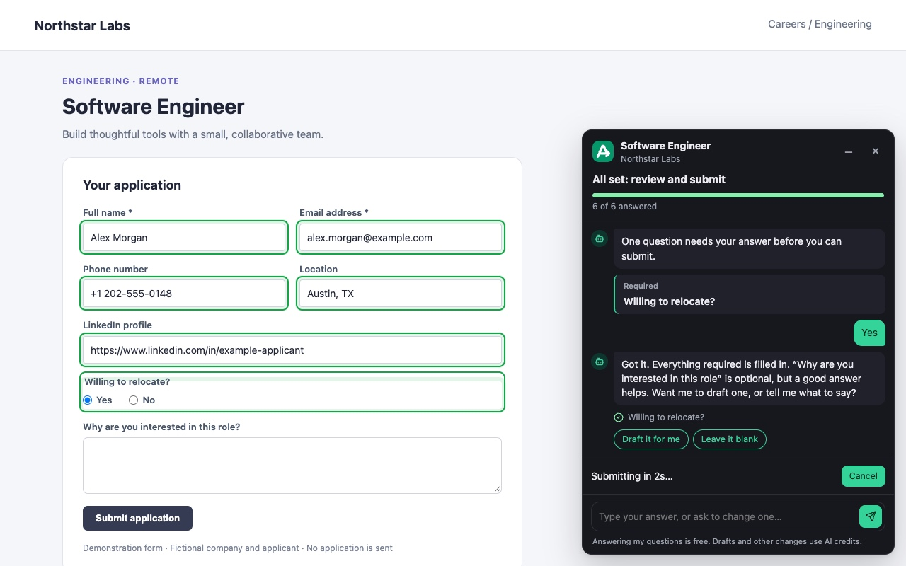
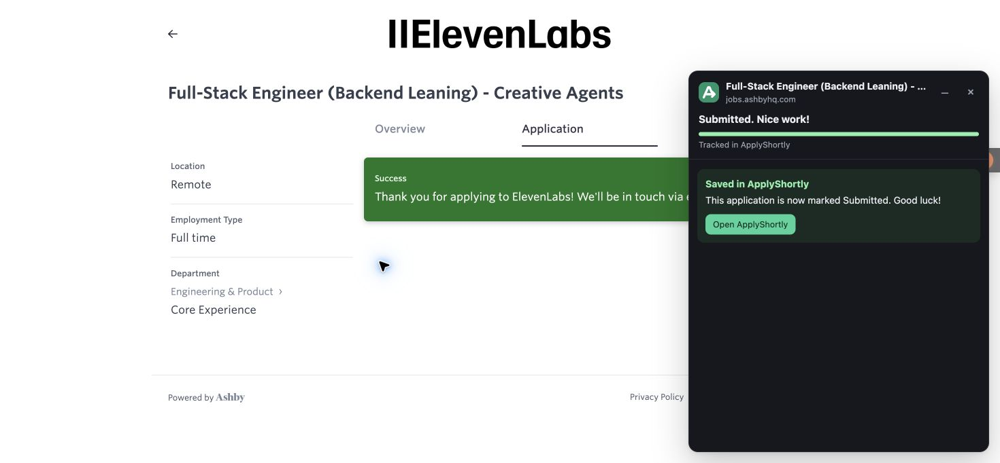
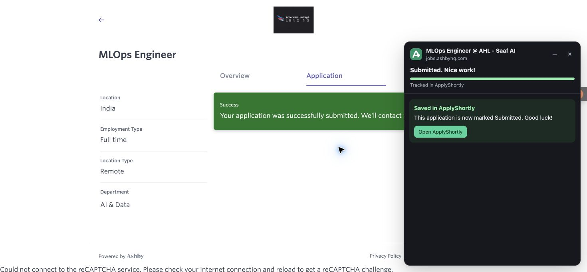

# ApplyShortly Chrome Extension Guide: Job Application Autofill

**Apply Shortly Form Agent** fills job application forms in your Chrome browser from your ApplyShortly profile and saved answer bank. Reuse contact details, work history, education and screening answers, get optional AI drafts, and review the completed application before submission.

[Install the Chrome extension](https://chromewebstore.google.com/detail/apply-shortly-form-assist/pdeffhelbeobnpcbjdegddcfimglmedd) · [ApplyShortly website](https://applyshortly.com) · [Source and developer README](../README.md)

The form agent helps with multi-step applications, pop-ups and embedded forms on pages you start it on, including forms behind your own login. Site support varies, and you handle sign-in, CAPTCHAs, consent and any fields it cannot complete. Submit on the employer's site yourself, or explicitly choose **Fill and submit** to submit after required-field checks and a cancellable countdown. The form agent itself never clicks final Submit.

## Quick start: autofill a job application

1. Install the extension from the Chrome Web Store and sign in to [ApplyShortly](https://applyshortly.com).
2. Save your profile, résumé and application answers in ApplyShortly, then open the extension settings to check your connection.
3. Open a job application in Chrome. Choose **Fill this form** or press **Alt+Shift+F**.
4. Answer remaining questions in the on-page panel, review the fields and attachments, and complete any manual steps.
5. Click the employer's Submit button, or explicitly choose **Submit for me (Fill and submit)** and use Cancel during the countdown if needed.

Filling from your profile and saved answers is free with an ApplyShortly account. Optional AI features use credits or a supported personal AI provider key; provider charges may apply.

## Guide contents

- [Extension screenshots](#screenshots)
- [Installation and account connection](#install)
- [Build and load an unpacked extension](#build-from-source)
- [Autofill, form agent and Fill and submit](#use)
- [How saved answers are chosen](#how-answers-are-chosen)
- [Chrome permissions](#why-it-asks-for-these-permissions)
- [Form compatibility and limitations](#limits)
- [External AI assistant control pilot](#external-ai-assistant-control-pilot)

Plain JavaScript with no compilation step. The build packages an allowlisted set of runtime files;
it never reads `.env` or includes local credentials. An ApplyShortly account is required,
including when using a personal AI key. See `../extension-bridge/README.md` for the API.

## Screenshots

### Job application autofill and Fill and submit



*The demo shows saved details filled into the application, a screening answer supplied in chat, optional AI drafting and the cancellable submission countdown. The company and applicant are fictional; no application is sent.*

### Submission confirmation



*The employer page confirms the submission, and the extension shows the application saved in ApplyShortly.*

### Application tracking



*The panel reflects a confirmed application and provides an Open ApplyShortly button to return to your account.*

These existing captures show individual application outcomes. Form support varies by website; they do not establish compatibility with every employer or ATS. Employer names and logos identify the pages shown and do not imply endorsement.

## Install

Install it from the [Chrome Web Store](https://chromewebstore.google.com/detail/apply-shortly-form-assist/pdeffhelbeobnpcbjdegddcfimglmedd). The store package is built for
`https://applyshortly.com`. For development, build and load it unpacked
as below. For Chrome Web Store releases, see the [publishing guide](../docs/operations/extension-publishing.md).

## Build from source

From the repository root:

```sh
make extension-build
# Reads FRONTEND_URL from environment or root .env. Optional explicit override:
make extension-build platform_url=https://applyshortly.com
make extension-source
make install
make extension-test
```

The build writes `dist/extension/` and `dist/applyshortly-extension-0.4.0.zip`.
Open `chrome://extensions`, enable **Developer mode**, click **Load unpacked**, and select
`dist/extension/` (not the ZIP). Source `extension/` checkouts default to localhost; use the built directory for `.env` configuration.
After rebuilding, click **Reload** in Chrome and reload the application page.

Open extension settings. Setup silently connects when you are already signed in to the website.
Otherwise, click **Sign in with ApplyShortly** to open sign-in. There is no Platform URL field:
the package contains the public `FRONTEND_URL` selected at build time (explicit `--platform-url`,
environment, root `.env`, then localhost development default). Rebuild after changing this value.
The package includes permission for that origin; `.env` and its other values are never packaged.
Changing the packaged origin clears the previous server's connection once. Sign in again to
connect to the new server; subsequent checks preserve an in-progress code pairing.
The extension shows **Connected as**, your plan and credits, and never
displays the generated connection credential.
Use **Open ApplyShortly** to open the website with your extension account. A different website
account or an unrecognized browser asks for confirmation first.

Sign-in stays in sync with the website in this browser. Signing in to ApplyShortly connects the
extension on its own: any open ApplyShortly page reports it, and settings re-check when opened or
revisited. **Log out** in extension settings or on the website signs this browser out of both; the
other side notices on its next request, or when its tab regains focus. Other devices stay signed
in. To switch accounts, log out and sign in as the other account. To revoke access, log out,
revoke the named automatic key, or revoke a linked website session. Manual API-key connections
are independent of the website; logging out of the extension revokes that key.

For automatic sign-in, operators set `EXTENSION_IDS` to the ID shown at `chrome://extensions`.
The exact callback is `https://<extension-id>.chromiumapp.org/applyshortly`.
An older server without the browser configuration endpoint, or an empty/unmatched allowlist,
falls back to code pairing after clicking Sign in: compare the displayed codes and approve
in the website. Legacy codes expire after ten minutes and credentials remain independent of
website logout. Reopen settings to resume polling; use Cancel to stop locally.
A saved profile is needed for autofill, but not for connecting an account.

Manual connection remains available: create a per-user `jh_…` key in **Settings → API keys** and
paste it under **Advanced: manual API-key connection** in extension settings. Old `EXTENSION_API_TOKEN`/`extension-config` instructions no longer
apply. No shared token or credential-seeding file is distributed or loaded.

### The agent panel

In the AI-led engine, questions inspect the page without editing it. Explicit instructions such
as "Recover this application", "Proceed with the edits", and "Please remove blank rows"
allow the agent to make the requested changes. Recovery retains the session's AI spending
limits; resuming does not reset them.

The floating panel is one chat: the ApplyShortly agent, the same as the review chat on the
website. There is no separate assistant, agent button or question box. It fills the form, steps
through it when it has more than one page, drafts answers and asks you what it can't answer. It asks the unanswered questions one at a time, shows the form's options as tappable replies, and
fills the fields as you answer; you can also ask it to change an answer ("set notice period to
60 days"). An open question (like "Why are you suitable for this role?") comes with a
**Draft it for me** button, required or not, and typing "draft it for me" does the same; personal
facts (experience, notice period, joining date, names, numbers) are never drafted. Calendar fields
use a saved start date, or today when your saved notice period is zero; otherwise they wait for
your answer. Annual compensation is filled from saved expectations only when the question's
currency matches. Instructions to change several fields go to the assistant instead of being
copied into the current answer. Optional questions nothing could answer (like "Why are you a good fit?") are offered
next: **Draft it for me** writes an AI draft from your profile and the job, **Leave it blank** skips
it. Last, it brings up what only you can do: a consent checkbox (**I agree, tick it** ticks it only
when you tap it, or tick it yourself; it works the same after the form agent has finished a run) and file uploads (**Show me** highlights the field). When the
page needs clicking through, the chat says so and carries on by itself (see [Stepping through a
form](#stepping-through-a-form)): no form on the page yet (it opens after an *Apply* button or in a
pop-up), a **Next** / **Continue** button and no Submit (a multi-step form), or a large frame and
next to no fields (an embedded form). Typing "do the rest" or "go to the next page" does the same. Answering the question the chat just asked
(tapping an option, or typing the answer to a text question) is written straight into the form
with no AI call and no credit; anything else goes to the assistant. Answers from chat are marked **From chat**. The conversation stays in
the page and is gone when you leave it. Only the page's question labels, options and current
values are sent with each message, never the rest of the page. The AI never answers checkboxes
or uploads. Each reply costs 1 credit unless you use a personal AI key, and the
assistant never submits.

Ashby Yes/No buttons are counted as screening questions, including a selected **No**.
Required multi-select questions count as one question and stay open until you select an option.
Consent still asks for your explicit choice. Fill and submit waits for those required answers;
a new positive Ashby **Success** receipt confirms the submission in ApplyShortly.

### AI-led controller

The AI-led engine and a connected assistant run the same page commands (`extension/src/agent/commands.js`): guarded, read back from the page, with `fill_form` (several fields in one call), `options` and `review`. When the platform reports `verified_commands`, the AI-led engine uses them too and sends each action's `result`; the panel says who it is run by (ApplyShortly or your assistant).

Protocol 2 pauses locally before another planning call when a page state appears three times within the last ten observations (one state, or two taking turns, such as a pop-up that keeps closing and reopening), or after forty planning calls since user input/resume. The platform also pauses after six decisions without progress and caps AI spend at about $1 per application. Resume explicitly after checking the page; each resume starts a new safety window.

Escape is sent only into an open dropdown list, never into the page, where it would close an application pop-up. A browser dialog (alert, confirm, "Leave site?") is handed to you and never answered by the agent; the run continues by itself once you close it. Besides click, type, choose, check, upload, keys, scroll and wait, the agent can hover, drag between two controls, and wait for text to appear. Screenshots are capped at 1280 pixels on the longest side, and taken only when the page layout changed. Taking one changes nothing on the page: the capture is shrunk and labelled inside the extension (never with Chrome's clip option, which briefly resizes the page), and the panel stays in place. A field already on screen is filled without scrolling. Your saved answers for plain fields (text, email, numbers, native dropdowns) are typed in one go without an AI call; the AI handles pickers, phone numbers, uploads and anything that didn't stick.

Choose **Extension settings → Preferences → Extension form filling method** for new extension sessions. The platform has a separate account setting. AI-led is the default for both.
AI-led is the service default. It uses fresh page observations, screenshots
and native AI tool calls; Anthropic and Gemini native tools are supported. Personal OpenAI
keys support structured drafts rather than this native tool loop; sessions on those keys, or with
no AI, run Rules-led instead.

With controller protocol 2 (the server default), the extension inspects the page before filling
and keeps page questions, actions and review in one session. Messages interrupt pending actions
and receive fresh page context. Page questions stay read-only until you ask it to edit or
continue. The controller tracks field readback and user edits, bounds failed interaction
strategies, and can follow an application tab opened by its recent click. It stops for review;
the agent itself never clicks final Submit. Stop ends browser access.

This upgraded session sends visible page context and transient screenshots to the configured
AI provider through ApplyShortly. The panel stays visible (the AI is told it is ApplyShortly's own) and lets clicks through while the agent acts. The classic
assistant description above applies outside this upgraded session.

The server gate defaults on. Reload the updated extension and start a new session after an
upgrade; active sessions keep their negotiated protocol. Scripted browser tests cover these
mechanics, but representative real-model ATS reliability has not been established.

### Configure an endpoint on this device

The current source build supports a custom endpoint for answer drafting and assistant chat. Availability in the
Chrome Web Store depends on a future release. An ApplyShortly account and server connection are
still required to retrieve the profile and saved answers.

1. In extension settings, open **My AI provider**.
2. Enter the API **base URL**, including its API prefix, a model identifier, and an API key if the
   service requires one. The extension appends `/chat/completions` to the base URL. The endpoint
   must support OpenAI-style chat completions; provider implementations and model capabilities vary.
3. Choose **Save and use for AI**, then **Test connection**. The test makes a short real model
   request and may incur provider charges. On failure, check the URL, key, model and server status.

For example, the LLM CLI Gateway uses `http://127.0.0.1:8765/v1`, a gateway API key and a model
such as `agy/gemini-3.8-flash-medium`. A local Ollama server commonly uses
`http://127.0.0.1:11434/v1` and a locally installed model; its API key can be left blank when the
server does not require one. OpenRouter uses `https://openrouter.ai/api/v1` with an OpenRouter key
and model ID. Local services must be running on the same computer as Chrome. Remote endpoints must
use HTTPS; HTTP is allowed only for localhost and loopback addresses. URLs cannot contain embedded
credentials, query parameters or fragments.

The background worker sends the question and relevant professional profile and job information
directly to the selected endpoint. The provider receives the saved profile and answers as context, does not fall back
to ApplyShortly AI on provider failure, and marks generated answers for review. Custom endpoint mode
uses the method selected in extension settings on this device. With AI-led selected, the extension sends page observations, the candidate profile, job context, previous actions and conversation directly to the custom provider for planning, and runs returned commands through the same verified controller. Screenshots are not sent to the custom provider. The provider must follow the requested JSON format; an invalid response stops the run rather than switching providers or engines. Chat sends the conversation, form fields and values, and relevant professional profile information directly to the custom provider. No ApplyShortly AI credits are used for these requests. The server must support custom-planner negotiation.
The provider's own billing and data policies apply.

The key stays in trusted extension-local storage on this device and is removed on sign-out or when
the custom provider is removed. Selecting ApplyShortly credits
also removes the custom configuration. Re-enter the key when saving changes. Local extension storage
is not an encrypted credential vault.

Localhost and loopback forms can be filled without registering them as job postings. They are shown
as **Not tracked in ApplyShortly** and do not create application records. A manual Chrome test of a
fictional local form filled profile fields and a reviewed draft via the LLM CLI Gateway, then
submitted only to the local test page. This is one tested flow, not a guarantee for all providers,
models or job forms.

### My AI provider

In extension Settings → **My AI provider**, choose OpenAI, Gemini, Anthropic or Custom URL.
The preset supplies the base URL and a default model; a model override is optional for presets.
Custom URLs require a model. Grant access to that origin, save your key, then test the connection.
The key stays in trusted extension-local storage, never Chrome sync, and is removed on sign-out.
Chat, **Draft it for me**, and AI-led planning send their context directly to your provider.
There is no fallback to platform credits. In-app browser, Autopilot and scheduled AI stay on
platform credits. Choose credits explicitly to return to the platform flow.

Gemini uses its OpenAI-compatible endpoint. Anthropic uses a small native Messages adapter with
its API-key, version and direct-browser headers. Both planners request JSON actions as text;
provider-native tool calling is not needed for this path. Mocked tests validate the wire formats,
not real credentials, model availability, or browser CORS. **Test connection** makes a real billable
request from your installed extension; organizations can restrict direct-browser requests.

Existing encrypted server keys are retained but cannot be used or replaced. Re-enter a key on the
device, save it, then test it. Only after a successful test does **Delete retained server key**
allow you to remove the matching provider's old server key. No server key is copied to the device.
Generated answers need review. Profile fills remain free.

### Standalone source archive

`npm run build:source` additionally writes `dist/applyshortly-extension-source-0.4.0.zip`.
It contains extension and bridge source, tests, packaging scripts, MIT license and brand notes;
it contains no backend code, credentials, or repository history. It is ready for a separate public
repository, but this command does not publish anything. See `LICENSE` and `BRANDING.md`.

For an extracted source archive, run `npm ci`, `npm run check` and `npm run build`.

## Use

- **From the platform:** **Apply in your browser** (row menu or after a failed run), and **Prepare & review** on a job board, open the posting with `#jobhunt-autofill=<id>`. The extension fills the form on its own.
  **Apply** on a job board or sign-in site adds a one-time code (`&jobhunt-auto=<code>`, valid 10 minutes). The extension claims it (`POST /api/extension/applications/{id}/auto-apply`) and, once claimed, runs **⚡ Fill and submit** on that page: the same checks and cancellable countdown. Reloading the page, or a link made anywhere else, only fills.
- **On any page:** click the toolbar icon. The popup shows whether the page is a job in ApplyShortly
  (`/applications/lookup`) and offers two choices, each with a line saying what it does:
  - **Fill this form**: fills what it can, then the panel asks you the rest. You check and submit.
    On a page that isn't tracked it fills the same way, with nothing recorded.
  - **⚡ Fill and submit**: the same, then submits after a countdown (below).

  **Alt+Shift+F** fills without the popup. You can change it at
  `chrome://extensions/shortcuts`.

The panel at the bottom right has:

- **A headline and progress bar**, e.g. *6 things left for you · 11 of 17 answered* (the agent's
  status instead while it runs).
- **The assistant chat** (see above), or the agent's progress, questions and step log.
- **Submit for me** (panel footer; disabled until every required answer is in) and **⚡ Fill and submit**
  (in the popup, for tracked and untracked pages alike; it fills the form straight away first): click the
  form's own Submit button after a 3-second countdown with **Cancel**. It refuses, and
  says why, when a required field (including a consent checkbox or an upload) still needs you,
  when it can't find exactly one Submit button (multi-step forms stop at **Next**), when that
  button is still disabled, when the browser or the site reports an invalid field, or when the
  application is already sent or waiting for verification. A hidden field the site's uploader fills
  (like `resume.fileName`) gets up to 5 seconds to finish uploading; if the site still hasn't
  registered the file, the upload goes back on your list with "attach it again". Minimising or closing the panel cancels the countdown. AI drafts you haven't
  checked are submitted as filled, so use it when you trust your answer bank. The attempt is
  reported as *submission attempted* until a confirmation is detected or you mark it.
- **I already submitted it** (footer, tracked pages) covers sites where it can't detect the submit.

Answers already present when filling starts count toward completion and are checked against the site's validation. Rerunning preserves the source and review flags of answers filled in the current session.

When you type an answer on the page, the panel notices and moves on to the next question. **–** or Esc shrinks the panel to a pill showing what's
left. It stays minimised on later pages until you open it again.

On the page, green fields are filled, amber means check it, and dashed red means it's your turn.
Hover over a field to see why. Errors say what to do: a rejected key offers **Open settings**, an
account without a profile yet offers **Set up profile** (the website's profile setup), and an
unreachable platform offers **Try again**.

### Stepping through a form

For forms it can't finish in place (an **Apply** button that opens a pop-up, multi-page wizards,
typeahead dropdowns, forms inside frames, single-page apps that change step without loading a
page), the chat carries on by driving the tab itself after **Fill this form**, and says so first.
Inside, this is the form agent (`src/agent/`); to you it is the same chat.

- It works in the tab you started it in, one tab at a time, step by step: it reads the page
  (every frame, open shadow roots, the open dialog only when one is up), asks your ApplyShortly
  server what to do next, then clicks and types with real input events and looks again.
- Answers your profile and answer bank cover are typed without any AI call. AI is used only to
  find the way through the form (one apply run's credits per form, or your personal key).
- It asks in the chat for an answer it doesn't have (type it, tap an option, **Draft it for me** on
  open questions, or **I'll fill it on the page**), for a CAPTCHA or sign-in (**Continue** once
  you've done it), and on job boards for the posting's own **Apply / Easy Apply** click, because
  there that can apply in one click. It never solves CAPTCHAs.
- The form agent never submits. When it has been through the form, the chat picks up anything
  still open. If you started with **Fill and submit** or **Apply with extension**, the panel resumes
  Fill and submit with the same required-field checks and cancellable countdown. Otherwise, review
  and submit yourself or choose **Submit for me**. Stopping the agent cancels that continuation;
  reloading or checking its status never replays approval.
- **Pause** and **Stop and take over** are always available. Chrome shows a "started debugging
  this browser" bar while it runs (the `debugger` permission); closing the bar stops it.

### Autopilot windows

When you turn on **Submit complete applications every night** in ApplyShortly, jobs on sites that
need your sign-in (Workday, Taleo, SuccessFactors, iCIMS, Oracle), or an application whose site
session lapsed before the night's submit, are handed to the extension. About once a minute the
service worker (an alarm, the `alarms` permission) asks `POST /api/extension/autopilot/next`. When
a job is due, the reply carries its link and a one-time code, and the extension opens the link in
its own unfocused window (`#jobhunt-autofill=<id>&jobhunt-auto=<code>`, http(s) only). From there
it is the usual Fill and submit: the code is claimed once, every required field must be answered, there
must be one Submit button, and the countdown still runs.

The window has nobody watching, so it is stricter than Fill and submit you start yourself: it never
starts the form agent (which would attach the debugger), never drafts answers with AI, and
doesn't submit while an answer is marked **Check**. It also stops on a sign-in page (a visible
password box or a `/login` path) and says so in the panel. Eight seconds after the click the
extension closes that tab, and only that tab. If nothing was submitted within 15 minutes it leaves
the window open and reports `failed` (`blocker_not_cleared`) so the job isn't offered again.
Anything it can't finish stays open for you. Job boards are never offered this way.

It is on by default (you opted in by turning on nightly submission) and can be switched off in
Settings: **Let Autopilot open sign-in jobs in a window**. Chrome must be running at your
Autopilot hour; otherwise the job waits and rolls to the next night.

## How answers are chosen

For each empty field, in order:

1. **Profile facts** (`src/fill.js` → `profileAnswer`): name and first/last name, email, phone,
   location, links, total experience, current company and title, highest qualification, college
   and branch, cover letter, summary.
   Annual compensation uses saved amounts in the matching currency. Questions explicitly in
   lakhs per annum (LPA) convert saved INR amounts to lakhs; monthly pay is not inferred.
2. **`POST /answers/suggest`** with `allow_generate: false`, which covers preferences (notice
   period, CTC, relocation, work authorisation, sponsorship) and the answer bank. If the full
   question doesn't match, it retries with the first sentence. *"Current CTC? Mention fixed and
   variable components separately."* is matched as *"Current CTC?"*.
3. **AI draft** using your selected payment mode, automatically unless *Let AI answer questions it can't find* is off (in the popup or
   Settings), and whenever you tap **Draft it for me**. On a page that isn't tracked in
   ApplyShortly, the draft request also carries the page's title and up to 6,000 characters of
   its visible text, so the AI knows the job ("What interests you about Outmarket?"). Profile and
   answer-bank lookups never send page text. If a draft fails, the chat says why (for example,
   no credits left).

Selects and radio groups (native and Google Forms' ARIA ones) are set when an answer matches one
option exactly, by yes/no, or by unambiguous containment. Otherwise they're left for you.
Custom dropdowns (Angular Material `mat-select` and other ARIA comboboxes) are opened, and the
matching option is clicked the same way.

Each answer write gives the form time to commit its state before the next field is filled.
After filling, the extension waits a moment for the page to validate and reads what the site says.
A value the site rejects is retried as a plain number ("5.6 years" → "5.6"); one it still rejects
is listed under **Needs you** with the site's own message. The panel only says *All set* when
nothing is left.
`<input type=file>` gets your résumé when its label says résumé/CV or it's the only upload.

## What it reports

| When | Event |
|---|---|
| Fill starts | `opened` |
| After each fill pass | `filled`, with filled and unresolved fields → the run shows *Ready for review* |
| You attempt submission | `submission_attempted` → *Needs verification*, excluded from submitted metrics until confirmed |
| Confirmation page or **I already submitted it** after verifying success | `submitted` → *Submitted*, preserving later application stages |
| An error stops the fill | `failed` |

The tab remembers its application, so later pages of a multi-page form on the same site are filled
and tracked too.

## Brand assets

The ApplyShortly A/arrow mark is defined in the platform website and copied to
`icons/logo.svg` for the popup and settings page. The toolbar PNGs are rasterized from the same
vector at 16, 48, and 128 pixels. The on-page panel embeds this SVG as a CSS data URL so it does
not need additional extension resource permissions. Keep these copies in sync when changing the mark.

## Files

| File | Role |
|---|---|
| `manifest.json` | MV3 manifest. Has host access to `localhost`/`127.0.0.1` and the public origin selected by packaging. |
| `platform.json` | Public default platform origin, generated by the build. Contains no credentials. |
| `src/background.js` | Service worker. Holds the API key and makes every platform request, so job sites never see the key or hit CORS. Tracks which application each tab is filling. |
| `src/bridge.js` | JS port of `extension-bridge/client.ts`. Keep the two in sync. |
| `src/fill.js` | Field discovery, labels, profile answers, writing values (pure DOM, tested in jsdom) |
| `src/content.js` | Runs the fill on the page, the Assistant tab's logic, live re-check, Fill and submit, submit detection |
| `src/panel-view.js` | The review panel (closed shadow DOM): draws `content.js`'s state and calls back for actions |
| `src/panel-model.js` | Pure helpers shared by the panel and popup: checklist and counts, friendly error messages |
| `src/agent/loop.js` | The form agent's loop in the service worker: observe every frame, ask `/agent/step`, act, settle |
| `src/agent/cdp.js` | Drives the tab through `chrome.debugger`: frames (cross-origin included), isolated worlds, trusted mouse and keyboard input, screenshots |
| `src/agent/page.js` | In-frame half of the agent (needs `fill.js`): describes the page and locates elements; refuses final submits. Pure DOM, tested in jsdom. The platform's server agent uses a copy. |
| `src/popup.*`, `src/options.*`, `src/ui.css` | Toolbar popup and settings page |
| `test/*.test.mjs` | `node --test extension/test/*.test.mjs` (tests use the root npm dependencies) |

`npm run typecheck` also type-checks `src/` from JSDoc (`tsconfig.extension.json`, `@types/chrome`).

## Why it asks for these permissions

- **Content scripts on every site.** A tab the website opens with `#jobhunt-autofill=<id>`, the
  later pages of a multi-page form, and the confirmation page after a submit must all run the
  scripts without a click on the extension: that is how filling starts by itself and how a
  submission is confirmed. Chrome injects on demand only into tabs the extension has site access
  to or was clicked in, so on-demand injection would break these flows. On other pages the
  scripts stay idle: one `hello` message to the service worker, and a watch on the `<html>`
  attribute the ApplyShortly website uses for its signed-in mark.
- **`alarms`.** The once-a-minute check for a job Autopilot has handed over (see Autopilot
  windows). It opens a window only for a link ApplyShortly returned, and only with the setting on.
- **`debugger`.** The form agent's trusted input and cross-origin frames
  (`src/agent/cdp.js`). It attaches only to the tab the agent was started in, and Chrome shows its
  debugging bar meanwhile.

## Limits

- **Google Forms file uploads** go through Google's own picker, which a page script can't fill.
  Use **Download CV**, then **Add file**.
- **Google Forms' dropdowns** ("Choose") are listed with the answer to pick, but not opened.
  Other custom dropdowns are opened and filled; one that behaves unlike the ARIA combobox pattern
  stays under **Needs you**.
- **Forms inside iframes** (e.g. an embedded Greenhouse board on a company site) aren't filled by
  autofill. The form agent fills them; or open the board's own URL.
- **The form agent** can't see inside closed shadow roots or Google's file picker, and needs
  Chrome 125 or later.
- **Submits done with `fetch`** on single-page apps aren't detected; use **Mark as submitted**.


### Automatic application tracking

Starting Fill this form, Fill and submit or the form agent registers that posting in the connected
account's web app, including pages opened directly on an employer's site. Repeated starts on the
same posting reuse its application. The extension sends the page URL, title and company for
tracking; it does not fetch job boards or submit just by registering a page.

A final Submit click records an attempt as **Needs verification**. An explicit application receipt
on the page, or your confirmation through **I already submitted it**, moves it to **Applied**.
Duplicate-profile errors do not count as a successful application. Temporary connection errors
queue outcome metadata locally and retry once a minute, even with Autopilot windows off.
Signing out discards this queue so it cannot sync to another account.

## External AI assistant control (pilot)

> [!WARNING]
> **Status: Feature Disabled**
> External assistant browser control (connecting ChatGPT, Claude or Codex to drive the extension) is currently disabled and disconnected. The extension will not connect to the external relay or permit external agent control. Basic autofill from your profile and answers continues to work natively for free.

Compatible servers can enable application-only MCP control. When enabled, users can open **Let your assistant fill applications**
from the popup, connect the browser, and approve the assistant's exact batch locally. Keep the
control page open. New answers require review; submission needs explicit batch submission
permission, validation and a cancellable countdown. Stop ends browser control. Login, CAPTCHA,
and new domains require your intervention. No ApplyShortly AI calls or preparation credits are
used in this mode; your assistant's plan limits still apply. General browser control and
screenshots are not exposed. This pilot is disabled by default on the server.

**Standing approval (optional, per account, off by default).** The connection page has "Let my
assistant apply for me without asking each time" (the same switch is in website Settings). While it is on,
your assistant's batches start approved, and a submit skips the answer-review prompt and the countdown;
the form must still validate with every required field answered. When a page shows a CAPTCHA, your
assistant still fills and reviews every other field, then asks you to complete the CAPTCHA and click the
site's own Submit; it never solves one, and a submit command is refused while it shows. It also stops at
emailed codes and sign-in pages, and a new domain still asks. Turning it on also requests Chrome all-sites
access in the same click. **Stop access** turns it off.

Batch approval requests Chrome access to the exact employer origins; approve new origins
separately if the application redirects. Check uploaded-resume parsing and entered answers
before local review. Required checked consent is validated alongside native form validity
and upload requirements. Submission must produce employer confirmation; an uncertain attempt
blocks retries.

One local Breezy HR application has completed through MCP, including extension filling,
resume upload, review, countdown and submission. This is limited live validation, not a claim
of general ATS or native ChatGPT/Claude connector compatibility. The local HTTP MCP test
client supplied decisions without platform AI calls. Production release remains separate.
Idle/disconnect detaches the driver; it does not resume an already filled tab. Inspect that
tab for an existing submission before starting again.

### Assistant connection and filling methods

Choose **Let your assistant fill applications** in the popup for the guided setup. Add the
connector URL shown there to your assistant, connect Chrome, choose applications with your
assistant, then review the selection and site permissions. A single online browser is selected
automatically. Closing the setup page keeps the connection active; **Stop access** ends it.

**Run by** identifies ApplyShortly or your connected assistant. Platform runs show
**Rules-led** or **AI-led** under **Filling details**; change the method in website
Extension settings → Preferences → Extension form filling method. Platform sessions use their separate website setting. Connected assistants use their own allowance.
**Fill and submit** is an explicit submission choice with the existing completion checks and
cancellable countdown. **Submission needs verification** requires checking the employer result
and resolving the attempt in ApplyShortly before retrying.


Embedded CAPTCHA widgets do not pause the form agent before filling accessible application
fields. Complete any verification the site requires at final review and submit on the page.
A challenge-only page that prevents access to the form still asks for your help immediately.

### Planning-session recovery

Transient protocol-2 planning failures retry the same request ID. After retries are exhausted,
the agent pauses and Resume retries that request; taking control invalidates its returned plan.
An expired platform session asks for Resume before creating a fresh session from the current
form. Previous skipped questions and answer permissions must be given again. Stop ends recovery.
The shared executor fixture corpus lives in `test/executor-contract.json`; both real-browser
executors are exercised by the platform's `backend/tests/browser/test_executor_contract.py`.
